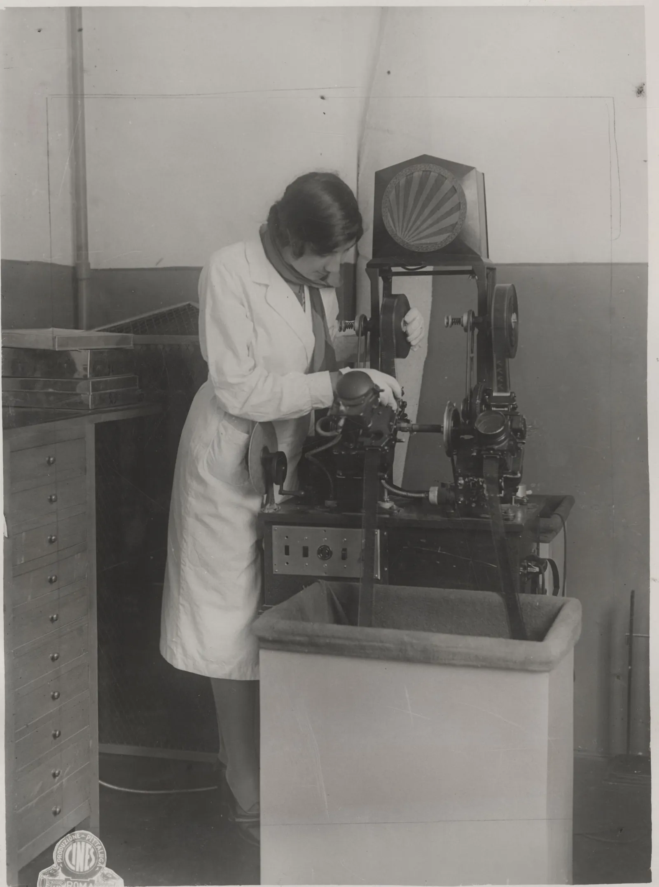

# Editing Pipeline

From selects to festival-ready export.

Photo: Touring Club Italiano (author unknown), CC BY-SA 4.0, via Wikimedia Commons

The job this chapter describes, in its first machine form: a technician at a vertical editing machine in 1930, cutting physical reels by hand. The pipeline below is the same discipline, selects, assembly, pacing, finish, at prompt speed.

## Assembly

- **Selects discipline:** generate 2 to 4 takes per shot, keep the best one. Kill darlings, a beautiful shot that doesn't serve the story is a deleted shot.
- **Cut to the story, not the footage:** the shot list is a plan, not a prison. If a generated shot is better than planned, re-cut around it.
- **Keep ratios honest:** 45 to 75 shots for a 3 to 5 minute film. Fewer, better shots beat more, weaker ones.

## Transitions and pacing

- **Cuts over effects.** Hard cuts are invisible; dissolves and wipes announce themselves. Use transitions only when time or place changes.
- **Pacing math:** action sequences cut faster (1 to 2s shots), emotional beats breathe (4 to 6s). Vary rhythm deliberately, monotony is the enemy.
- **The J-cut/L-cut:** let audio lead or lag the picture cut. Instant professionalism, costs nothing.

## Color

- **Match AI shots to each other first:** different models and prompts produce different grades. Normalize before styling.
- **One LUT direction for the whole film:** pick the palette in pre-production (era selection helps) and apply consistently.
- **The "expensive" grade:** restrained contrast, skin tones natural, shadows with detail. Over-saturated teal-and-orange reads cheap.
- **Free tools:** CapCut handles LUTs, grain, contrast, and saturation well enough for festival delivery.

## VFX touch-up

- **Cleanup passes:** inpaint glitches, stabilize micro-jitter, remove stray artifacts.
- **Face composite:** plasticky wide-shot faces get replaced with crops from close-shot frames.
- **Grain:** a light film-grain overlay unifies shots from different models, the cheapest consistency tool in post.
- **Upscale last:** finish the edit, then upscale the final timeline, never upscale individual clips and re-edit.

## Delivery

- **Export specs:** match the festival's required format, resolution, and codec exactly.
- **Watermark + packshot:** the Higgsfield festival requires both in the final video, build them into the export, not as an afterthought.
- **Watch it on three screens:** phone, laptop, TV. If it only looks good on one, the grade isn't done.
- **The 24-hour rule:** lock the cut, sleep, watch fresh. Every flaw you catch now is one the jury won't.

## The delivery checklist

- [ ] Picture lock before color and mix
- [ ] Color matched across all shots, one palette
- [ ] Sound mix final (dialogue > score > bed)
- [ ] VFX cleanup pass complete
- [ ] Watermark + packshot embedded
- [ ] Exported to festival spec
- [ ] Watched fresh on multiple screens
